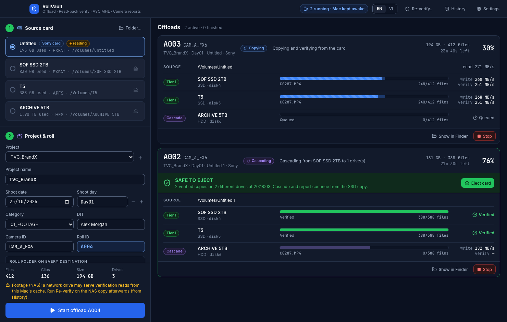
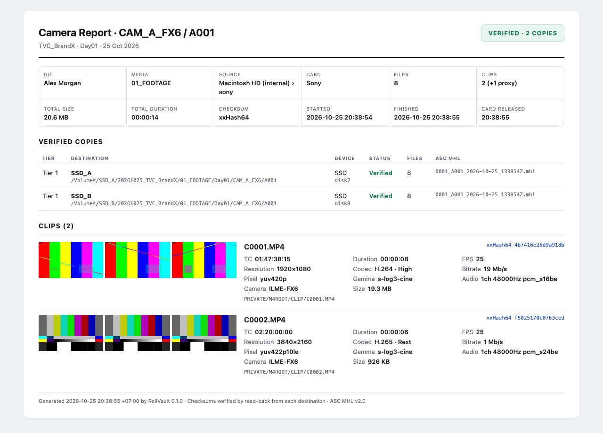

# RollVault

**Camera-card offload for DITs on macOS.** RollVault copies a card to several drives at once, verifies every copy by reading it back from the destination, cascades to HDD or NAS, writes ASC MHL and legacy MHL, and builds a camera report with thumbnails.



Built with Rust (copy engine), Tauri 2 and React. Apple Silicon, macOS 13 or later.

> **Status:** early (v0.1). The engine is covered by fault-injection tests, but it has not yet been proven on many real productions. Run it side by side with an established tool (OffShoot, Silverstack, ShotPut Pro) before relying on it alone.

## Why another offload tool

A DIT tool has one job: never lose footage, and be able to prove it. RollVault is built around failure modes, not the happy path. Unplugged drives, full disks, flaky card readers, hung NAS shares, app crashes and re-inserted cards are all tested.

## Features

- **Single read, multi-write.** Each chunk is read from the card once and written to every Tier 1 destination in parallel, with one writer and one verifier thread per drive.
- **Read-back verification.** Every file is flushed to the drive (`F_FULLFSYNC`), purged from the page cache, re-read with `F_NOCACHE` and hashed. Only then is it renamed from a hidden `.rvpart` file to its real name. A file with its real name on a destination is always a verified file.
- **Cascade.** HDD and NAS copies are made from a verified SSD copy, so the card can be ejected early. Every cascade copy is checked against the **original card hash**, not the intermediate copy.
- **Safe-to-eject policy.** The card is reported safe only when the required number of verified copies (default 2) exists on **different physical drives**. Two partitions on one drive count as one copy.
- **Never overwrites.** A roll folder that already contains data blocks the job. Roll IDs advance automatically and are remembered per camera and per project.
- **Hang-proof.** Every blocking I/O call is supervised. A destination, card or NAS stuck in a single call for more than two minutes is abandoned while the other copies continue. The UI never waits on a disk.
- **Resume after anything.** Each verified file is journaled immediately. After a cancel, power loss, crash or pulled card, press Resume. RollVault re-checks that the same card is inserted before continuing.
- **ASC MHL v2.0** with directory hashes and the C4 chain, plus **MHL v1.1** for older tools. Output is validated in tests against the official ASC reference tool and XSD schemas.
- **Re-verify** any roll folder later against its ASC MHL history. This detects bit rot, missing files and unrecorded files. It is useful for NAS copies and archive drives.
- **Camera report** in HTML and PDF. It includes three thumbnails per clip, codec, resolution, frame rate, timecode (including Sony XML sidecars and BWF audio), camera model, gamma, and the verified copy list.
- **Optional source re-read** that catches a card reader returning bad data.
- **Concurrent cards.** Several cards can offload at once. HDDs and NAS shares get one writer at a time, and free space is reserved per job.
- **On-set details.** The Mac is kept awake during jobs, a sound plays when a card is safe to eject, macOS notifications are sent, and cards can be ejected from the app.
- **English and Vietnamese** interface.



## Install and build

Requirements:

- Rust via [rustup](https://rustup.rs) (stable)
- Node.js 20 or later
- `brew install ffmpeg` for report thumbnails and metadata
- Google Chrome, optional, for PDF export

```bash
npm install
npm run tauri dev       # run in development
npm run tauri build     # produce RollVault.app and a .dmg
```

The app is written to `target/release/bundle/macos/RollVault.app`. Copy it to `/Applications` on the internal drive. Do not run RollVault from an external drive that you also use as a destination: if that drive disconnects, macOS can no longer page in the app's code.

The build is ad-hoc signed and not notarized. On another Mac, right-click the app and choose Open the first time.

## Using it

1. **Source card.** Insert a card. Camera cards are detected and selected automatically.
2. **Project and roll.** Set the project, shoot day, camera and roll. The destination folder path is previewed live.
3. **Destinations.** Mark drives as **Tier 1**, copied straight from the card, or **Cascade**, copied later from a verified Tier 1 copy. Correct the drive type (SSD, HDD, NAS) if macOS reports it wrongly.
4. Review the preflight checks and press **Start offload**.

The default folder layout is `{date}_{project}/{category}/{day}/{camera}/{roll}` and can be changed in Settings. Reports go to `{date}_{project}/03_DIT_REPORTS`.

### Command line

The same engine ships as a CLI:

```bash
rollvault-cli volumes
rollvault-cli offload --source /Volumes/Untitled \
  --primary "/Volumes/NVMe 2TB" --primary /Volumes/T5 --cascade /Volumes/Archive \
  --project TVC_BrandX --camera CAM_A --roll A001 --dit "Your Name" --report --pdf
rollvault-cli resume <job-id>
rollvault-cli verify "/Volumes/Archive/20261025_TVC_BrandX/01_FOOTAGE/Day01/CAM_A/A001"
rollvault-cli hash <file> --algo xxh64
```

Set `RV_LANG=vi` for Vietnamese messages.

## How it works

```
             ┌─> hasher ──────────────── source hash board
reader ──────┼─> writer[drive 0] ─> verifier[drive 0]
(card)       └─> writer[drive n] ─> verifier[drive n]
                         ▲
                 supervisor (stall watchdog)
```

- Page-aligned 8 MiB buffers are shared between the hasher and every writer, so the card is read exactly once.
- SSD destinations verify while copying. HDD and NAS destinations verify after the copy pass, so the heads are not thrashed.
- A device scheduler limits concurrent writers per physical drive and reserves free space across jobs.
- Files that fail verification are retried once. If the card returns different data on the second read, the file is reported as unstable.

Supported checksums are xxHash64 (default), XXH3-64, XXH128 and MD5.

## Project layout

```
crates/rollvault-core/      engine, testable without the UI
  src/transfer.rs           read-once / write-many pipeline with supervision
  src/job.rs                preflight, Tier 1, cascade, MHL, eject policy, resume
  src/ascmhl.rs             ASC MHL v2.0 writer (directory hashes, C4 chain)
  src/legacy_mhl.rs         MHL v1.1
  src/reverify.rs           re-verify a folder against its ASC MHL history
  src/report.rs             camera report: ffprobe, Sony XML, thumbnails, HTML/PDF
  src/volumes.rs            drive discovery, physical device identity, timeouts
  src/scheduler.rs          per-drive write permits and space reservations
  src/darwin_io.rs          F_NOCACHE, F_FULLFSYNC, cache purge, no-replace rename
  src/bin/rollvault-cli.rs  command-line front end
src-tauri/                  desktop app (Tauri 2)
src/                        UI (React 19, Tailwind 4)
design-system/rollvault/    UI design system
IMPLEMENTATION.md           original design notes (Vietnamese), superseded by this code
```

## Tests

```bash
cargo test -p rollvault-core -- --test-threads=4
```

The tests use real disk images (`hdiutil`), so every destination is a separate physical device. They inject these faults:

- a flipped bit on a destination
- a card reader returning bad data
- an unplugged destination, and a pulled and re-inserted card
- a destination or card that hangs forever
- a full disk
- cancel, then resume after an app restart
- a different card inserted at resume
- concurrent cards sharing destinations
- exFAT and FAT32 cards, and exFAT destinations
- the UI polling job status while a destination fails (deadlock regression)

To also validate the MHL output with the official ASC tools:

```bash
python3 -m venv .venv && .venv/bin/pip install ascmhl
# download ASCMHL.xsd and ASCMHLDirectory.xsd from github.com/ascmitc/mhl
ASCMHL_BIN=.venv/bin/ascmhl ASCMHL_XSD_DIR=/path/to/xsd cargo test -p rollvault-core
```

## Known limitations

- **Sony timecode.** Timecode is taken from the clip's timecode track when present, otherwise from the `M01.XML` sidecar using the standard LTC layout. The sidecar decoding has not yet been checked against many real Sony files.
- **NAS verification.** macOS may serve verification reads of network shares from its client cache. Run Re-verify on NAS copies afterwards, ideally after reconnecting the share.
- **exFAT drives.** macOS creates `._` AppleDouble files next to every file on exFAT. They are ignored in ASC MHL, as other DIT tools do.
- **RAW formats.** BRAW, R3D and ARRIRAW need vendor SDKs for thumbnails, so the report lists them with hashes only.
- **Laptops.** RollVault keeps the Mac awake, but closing a MacBook lid without an external display still sleeps it. The job stops and can be resumed.

## License

[MIT](LICENSE). The software is provided as is, without warranty. Always keep the camera card until RollVault reports it safe to eject, and test it alongside your existing workflow before relying on it.
